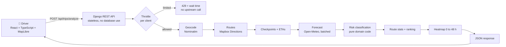
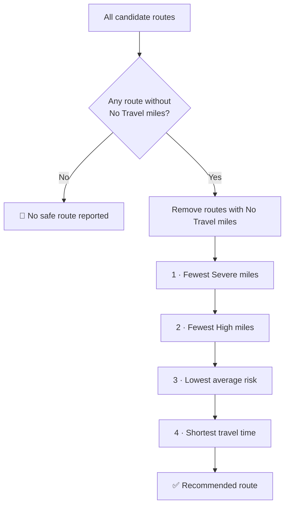

<div align="center">

# 🚛 Spotter: Weather-Aware Truck Routing

**Pick the safest of three routes using the forecast at the moment the truck actually arrives, the weight of the load, and the travel time.**


[🎬 **Watch the walkthrough**](https://youtu.be/ZtrUB_0MrGc) &nbsp;•&nbsp; [🌐 **Hosted app**](https://spotter-web-hqv1.onrender.com) &nbsp;•&nbsp; [🩺 **API health**](https://spotter-api-vh0l.onrender.com/api/health) &nbsp;•&nbsp; [📦 **Repository**](https://github.com/Achref47/spotter-weather-routing)

<br/>

<a href="https://youtu.be/ZtrUB_0MrGc">
  
</a>

<sub>▶ Click the thumbnail to watch the walkthrough (recorded locally, with a short tour of the hosted deployment at the end).</sub>

</div>

---

## 📑 Table of contents

1. [Reviewer quick start](#-reviewer-quick-start)
2. [What it does](#-what-it-does)
3. [Architecture and request flow](#-architecture-and-request-flow)
4. [Risk rules](#-risk-rules)
5. [Route recommendation](#-route-recommendation)
6. [Map, heatmap and forecast slider](#-map-heatmap-and-forecast-slider)
7. [CSV trip report](#-csv-trip-report)
8. [Simulated storm demo](#-simulated-storm-demo)
9. [API reference](#-api-reference)
10. [Project structure](#-project-structure)
11. [Run locally](#-run-locally)
12. [Environment variables](#-environment-variables)
13. [Testing and verification](#-testing-and-verification)
14. [Deployment on Render](#-deployment-on-render)
15. [Data providers and attribution](#-data-providers-and-attribution)
16. [Design decisions](#-design-decisions)
17. [Known limitations](#-known-limitations)
18. [Possible next steps](#-possible-next-steps)

---

## ⚡ Reviewer quick start

| I want to... | Do this |
|---|---|
| **See the whole app in 6 minutes** | Watch the [walkthrough video](https://youtu.be/ZtrUB_0MrGc). |
| **Try the hosted app** | Open https://spotter-web-hqv1.onrender.com and click **Run simulated storm demo**. |
| **Run a live forecast analysis** | Run the app locally ([instructions](#-run-locally)). Hosted live analysis depends on a free weather quota (see the note below). |
| **Check the rules and ranking** | Read [Risk rules](#-risk-rules) and [Route recommendation](#-route-recommendation), then `backend/trips/domain/`. |
| **Run the tests** | See [Testing and verification](#-testing-and-verification). |

> [!NOTE]
> **Hosted limits.** The hosted app runs on free tiers. The API sleeps when idle, so the first request after a pause can take about a minute. Live forecasts come from Open-Meteo's free API, which has a per-IP daily quota, and on this hosted deployment that quota has been reached during testing, so **live "Compare routes" may fail there**. The **simulated storm demo needs no weather service** and works on the hosted site. The live path works when run locally, which is what the walkthrough shows.

---

## ✨ What it does

A truck driver enters a trip and the app answers one question: *which route is safest, given the weather when I actually get there?*

| | Capability | Where it lives |
|---|---|---|
| 📝 | Origin, destination, departure time, load weight, checkpoint spacing (10 / 25 / 50 mi) | `TripForm.tsx` |
| 🛣️ | Up to three distinct routes | `services/routing.py` |
| 📍 | Checkpoints along each route with an estimated arrival time at each | `domain/checkpoints.py` |
| 🌦️ | Forecast sampled at **each checkpoint's arrival time** | `domain/weather_match.py`, `services/weather.py` |
| ⚠️ | Risk from wind, rain, snow and load weight | `domain/risk.py` |
| 🏆 | Recommended route with a step-by-step explanation | `domain/route_selection.py`, `RecommendationWhy.tsx` |
| 🗺️ | Interactive map with routes, checkpoints, popups | `MapView.tsx` (MapLibre GL) |
| 🔥 | Corridor weather heatmap with a 0 to 48 h slider | `domain/heatmap.py`, `HeatmapControl.tsx` |
| 📊 | Checkpoint table with units, click a mile to zoom | `CheckpointTable.tsx` |
| 📥 | Downloadable CSV trip report | `lib/csvReport.ts` |
| 🧪 | Clearly labelled simulated storm demo | `domain/demo_weather.py` |
| 🛡️ | Per-client rate limiting before any upstream call | `trips/throttling.py` |
| 🧯 | Loading, error, empty, incomplete-data and no-safe-route states | `App.tsx`, `lib/messages.ts` |

---

## 🏗️ Architecture and request flow



**Principles**

- **Pure domain, isolated I/O.** All business rules live in `backend/trips/domain/` as pure functions with no network access, so they are easy to test. Anything that talks to an outside service lives in `backend/trips/services/`.
- **Stateless backend.** No database use and no authentication. Everything needed arrives in the request.
- **Throttle first.** One analysis can need roughly 100 to 240 forecast locations, so the per-client limit runs *before* geocoding, routing or weather.
- **Honest about missing data.** A reading that is not available stays *unknown*; it is never converted to Low or zero.

---

## 🚦 Risk rules

Colours match the app's legend.

### Thresholds per condition

| Level | 🟢 Low | 🟡 Moderate | 🟠 High | 🔴 Severe | 🟣 No Travel |
|---|---|---|---|---|---|
| **Wind** (mph) | < 25 | 25 to < 35 | 35 to < 45 | 45 to < 55 | ≥ 55 |
| **Rain** (in/hr) | < 0.10 | 0.10 to < 0.25 | 0.25 to < 0.50 | 0.50 to 1.00 *inclusive* | > 1.00 |
| **Snow** (in/hr) | < 0.5 | 0.5 to < 1.0 | 1.0 to < 2.0 | 2.0 to 3.0 *inclusive* | > 3.0 |

### Load-weight overrides (wind only, strictly greater-than)

| Wind | Load | Result |
|---|---|---|
| ≥ 55 mph | any | 🟣 **No Travel** |
| 45 to < 55 mph | **> 30,000 lb** | 🟣 **No Travel** |
| 35 to < 45 mph | **> 40,000 lb** | 🔴 **Severe** |

A load of **exactly** 30,000 lb or 40,000 lb does **not** trigger its override.

### Interpretation rules

- A checkpoint's overall level is the **worst** of its wind, rain and snow levels.
- Wind is the **sustained** 10 m wind speed; gusts are not used.
- Rain includes the provider's `rain` and `showers` values.
- Load overrides apply to **wind only**.
- The stretch between two checkpoints takes the **worse of its two endpoints**, so no mile is counted twice.
- Missing weather values stay **unknown**, are excluded from the average risk, and are reported separately.

---

## 🏆 Route recommendation

Routes are compared with a **lexicographic order, not a weighted score**.



| Step | Criterion | Notes |
|---|---|---|
| 0 | **Safety gate** | A route with any No Travel miles is never recommended while a route without them exists. |
| 1 | Fewest Severe miles | |
| 2 | Fewest High miles | |
| 3 | Lowest average risk | Distance-weighted over miles with known weather, on a 0 to 4 scale: 0 Low, 1 Moderate, 2 High, 3 Severe, 4 No Travel. |
| 4 | Shortest travel time | |

The **"Why this route?"** panel shows the same trail: what the gate removed, which criteria were tied, and which one decided the result.

---

## 🗺️ Map, heatmap and forecast slider

- **Routes and checkpoints** are drawn on a MapLibre GL map. Each checkpoint dot is coloured by its risk level and opens a popup. The checkpoint table lets you click a mile to zoom the map to it.
- **Heatmap.** A halo layer shows forecast risk along the trip corridor, computed with the same rules and your load weight.
- **Forecast slider (0 to 48 h).** It shows the corridor's forecast risk at *departure + N hours*, in your local time. It is **not** tied to where the truck is at that moment. The route cards and the checkpoint table use each route's own arrival times. The panel says so on screen.
- The heatmap can be switched off with its checkbox.

---

## 📥 CSV trip report

The **Download trip report (CSV)** button exports the current analysis. It is offered only while a result is showing, so a loading or failed request can never export stale data.

| Section | Contents |
|---|---|
| Header | Title, generation time, forecast source, live or simulated |
| Trip summary | Origin, destination, departure, load (lb), interval (mi), recommended route, the "Why this route?" criteria |
| Route comparison | Distance (mi), duration, ETA, No Travel / Severe / High / unknown miles, average risk (0 to 4) |
| Checkpoint details | For every route: mile, ETA, wind (mph), rain (in/hr), snow (in/hr), risk level |

**Format rules**

- Timestamps are **UTC** (ISO 8601). "Report generated" is the download time, separate from the trip's departure.
- Unknown readings are written as `unknown`, never `0`.
- Text cells starting with `=`, `+`, `-`, `@`, tab or carriage return get a leading apostrophe to prevent spreadsheet **formula injection**. Typed numbers are left unchanged. Standard CSV quoting applies.
- UTF-8 byte-order mark for spreadsheet compatibility.
- Filename: `spotter-trip-report-YYYYMMDDTHHMMSSZ.csv`.
- **Simulated analyses** start with the exact line `SIMULATED STORM — NOT A LIVE FORECAST`, and the filename contains `-SIMULATED-STORM-`.

---

## 🌩️ Simulated storm demo

A deterministic, clearly labelled scenario that lays a storm over the fastest route, so the risk rules, the No Travel gate and the no-safe-route behaviour can be seen without waiting for bad weather.

- It reuses the **same risk engine and load overrides**; only the weather readings are simulated. No weather service is called.
- The storm builds for three hours, holds for eight hours, then fades, centred halfway along the fastest route.
- It is labelled on the map, in the sidebar, in the heatmap note and in the CSV.
- Try a lighter load and a heavier load to see the wind overrides change the result.

---

## 🔌 API reference

| Method | Path | Purpose |
|---|---|---|
| `GET` | `/api/health` | Health check, returns `{"status": "ok"}` |
| `POST` | `/api/trips/analyze` | Analyze a trip |

<details>
<summary><b>Request body</b></summary>

```json
{
  "origin": "Houston, TX",
  "destination": "Atlanta, GA",
  "departure_time": "2026-10-20T08:00:00Z",
  "load_weight_lb": 42000,
  "checkpoint_interval_mi": 25,
  "demo_scenario": null
}
```

- `checkpoint_interval_mi`: `10`, `25` or `50`.
- `load_weight_lb`: 0 to 80,000.
- `departure_time`: at most about 5 minutes in the past, and within 7 days.
- `demo_scenario`: `null` for live analysis, or `"storm"` for the simulated demo.

</details>

<details>
<summary><b>Response shape</b></summary>

```text
origin, destination, departure_time, load_weight_lb, checkpoint_interval_mi
weather_source        "live" or "demo"
routes[]              id, label, distance_mi, duration_s, arrival_time, geometry,
                      checkpoints[], summary (miles per level, avg_risk), rank
recommendation        route_id (or null), status, explanation, comparison trail
heatmap               start_time, hours, legend, points[]
warnings[]
```

The full TypeScript contract is in `frontend/src/types.ts`.

</details>

<details>
<summary><b>Errors</b></summary>

Validation problems return `400` with readable field messages. The per-client limiter returns `429` with a wait time and never reaches an upstream service. Upstream or availability problems are reported with a clear message instead of a stack trace.

</details>

---

## 🗂️ Project structure

```text
spotter-weather-routing/
├── render.yaml                 # Render Blueprint (API + static site)
├── .env.example                # safe placeholders, never commit .env
├── docs/DEPLOYMENT.md          # variable table and Render steps
├── backend/
│   ├── config/                 # Django settings (env-driven, fail-closed in production)
│   └── trips/
│       ├── serializers.py      # request validation
│       ├── views.py            # health + analyze endpoints
│       ├── throttling.py       # per-client rate limiting
│       ├── errors.py           # API error handling
│       ├── domain/             # PURE business logic
│       │   ├── checkpoints.py  risk.py  weather_match.py
│       │   ├── route_selection.py  route_stats.py
│       │   └── heatmap.py  demo_weather.py
│       ├── services/           # external I/O
│       │   ├── analysis.py  routing.py  weather.py  geocoding.py
│       └── tests/              # domain, integration, API, production-settings tests
└── frontend/
    └── src/
        ├── App.tsx  api.ts  types.ts
        ├── components/         # TripForm, RouteList, MapView, CheckpointTable,
        │                       # HeatmapControl, RecommendationWhy, WeatherSourceBanner, ReportButton
        └── lib/                # pure helpers + tests (format, csvReport, recommendation, ...)
```

---

## 💻 Run locally

**Requirements:** Python 3.11, Node 22 (Vite 8 needs Node 20.19+ or 22.12+), and a Mapbox token.

```powershell
# 1. Environment file (never commit .env)
Copy-Item .env.example .env
# edit .env and set MAPBOX_TOKEN; the other defaults work locally

# 2. Backend
cd backend
python -m venv .venv
.\.venv\Scripts\Activate.ps1
pip install -r requirements.txt
python manage.py runserver

# 3. Frontend (second terminal)
cd frontend
npm install
npm run dev          # open http://localhost:5173
```

> [!TIP]
> Django may print a notice about unapplied migrations. The app is stateless and does not use the database, so it is harmless.

> [!IMPORTANT]
> Open the app at `http://localhost:5173` (not `127.0.0.1`). The default `CORS_ALLOWED_ORIGINS` allows `http://localhost:5173`.

**Manual check:** run Houston, TX → Atlanta, GA with a departure in the next few days. Confirm three routes, checkpoints, the heatmap slider and the CSV download. Then run the simulated storm demo and confirm the banner, the excluded No Travel routes and the simulated CSV.

---

## ⚙️ Environment variables

Full table with deployment notes: [`docs/DEPLOYMENT.md`](docs/DEPLOYMENT.md).

| Variable | Used by | Secret | Purpose |
|---|---|---|---|
| `MAPBOX_TOKEN` | backend | 🔒 yes | Routing |
| `DJANGO_SECRET_KEY` | backend | 🔒 yes | Required, at least 50 characters, when `DJANGO_DEBUG` is `false` |
| `DJANGO_DEBUG` | backend | no | `true` locally; must be `false` in production |
| `DJANGO_ALLOWED_HOSTS` | backend | no | Comma-separated hostnames |
| `CORS_ALLOWED_ORIGINS` | backend | no | Comma-separated frontend origins (required in production) |
| `NUM_PROXIES` | backend | no | Proxies in front of the app, for the throttle (`1` on Render) |
| `OPEN_METEO_MODEL` | backend | no | Optional; default `ecmwf_ifs025` |
| `ANALYZE_RATE_BURST`, `ANALYZE_RATE_HOUR` | backend | no | Optional; default `10/min` and `30/hour` per client |
| `VITE_API_URL` | frontend (build time) | no | Backend origin, no trailing slash |

**Production settings fail closed:** with debug off, the app refuses to start if the secret key is weak, or if allowed hosts or CORS origins are missing. On Render it also refuses to start if debug is on.

---

## ✅ Testing and verification

```powershell
# Backend
cd backend
python manage.py check
python -m pytest -q

# Frontend
cd frontend
npm run lint
npm test
npm run build
```

- **Backend tests** cover the risk thresholds and boundaries, load overrides, route statistics and ranking, unknown handling, API behaviour, throttling and the production settings.
- **Frontend tests** (Node's built-in test runner) cover formatting, the trip-form validation, error messages, map data helpers, the recommendation explanation and the CSV report (quoting, formula protection, units, simulated labelling, no mutation of the analysis).
- No test makes an external API call.

> [!NOTE]
> Counts are intentionally not hard-coded here. Run the commands above for the current totals.

---

## ☁️ Deployment on Render

[`render.yaml`](render.yaml) defines two services:

| Service | Type | Notes |
|---|---|---|
| `spotter-api` | Python web service | Gunicorn, one worker with four threads, 120 s timeout, health check on `/api/health` |
| `spotter-web` | Static site | Vite build, with `VITE_API_URL` set at build time |

Secrets and URLs are entered in the Render dashboard and are **not** in the repository. Steps and the variable table are in [`docs/DEPLOYMENT.md`](docs/DEPLOYMENT.md).

**Why one worker with threads?** The throttle counters and the weather and geocoding caches live in memory, so a single process keeps them consistent.

---

## 🙏 Data providers and attribution

| Provider | Used for | Notes |
|---|---|---|
| [Mapbox Directions API](https://docs.mapbox.com/api/navigation/directions/) | Routes and durations | Attribution shown in the app. [Mapbox attribution guide](https://docs.mapbox.com/help/dive-deeper/attribution/). Mapbox's Terms of Service may restrict how Directions results are displayed (for example on non-Mapbox maps). I could not confirm the Directions-specific wording, so review the current terms before any use beyond this assessment. |
| [Open-Meteo](https://open-meteo.com/) | Hourly wind, rain, showers, snowfall | "Weather data by Open-Meteo.com" is shown. Data is CC BY 4.0. The free API is for non-commercial use with published limits of fewer than 10,000 calls per day, 5,000 per hour and 600 per minute ([terms](https://open-meteo.com/en/terms)). |
| [Nominatim](https://nominatim.org/) (OpenStreetMap) | Geocoding | [Usage policy](https://operations.osmfoundation.org/policies/nominatim/): identify the application with a User-Agent, at most 1 request per second, cache results, show attribution. The app sends a descriptive User-Agent and spaces requests at least one second apart. Attribution: [OpenStreetMap contributors](https://www.openstreetmap.org/copyright). |
| [OpenFreeMap](https://openfreemap.org/) | Basemap tiles (MapLibre GL) | Attribution shown on the map. |

This README is not legal advice; check each provider's current terms.

---

## 🧠 Design decisions

1. **Lexicographic ranking with a hard safety gate.** It matches the specification exactly, and the explanation panel is built from the same data as the ranking, so the two cannot disagree.
2. **Unknown stays unknown.** Treating a missing reading as Low would make a route look safer than the data supports.
3. **Throttle before upstream calls.** Protects third-party quotas and keeps abusive traffic cheap.
4. **Batched, cached weather lookups.** Forecasts for many locations are requested in batches, in parallel, with a retry, and cached briefly per location.
5. **The simulation reuses the real engine.** The demo only produces readings; the same classifier scores them, so it exercises the real rules.
6. **The CSV exporter is a pure module.** It reads the existing response, reuses the same explanation as the UI, and is tested without a browser.
7. **Fail-closed production settings.** Misconfiguration stops the app at startup instead of running insecurely.

---

## ⚠️ Known limitations

- **Truck ETAs are optimistic.** Mapbox's driving profile uses car speeds, not truck speeds.
- **Forecasts are uncertain and coarse.** Values come from a weather model on a grid (default `ecmwf_ifs025`, about 0.25°), not from observations at the road. Rain and snow rates are model estimates.
- **Unknown data.** Missing readings are shown as unknown and excluded from average risk; unknown miles are reported separately.
- **Provider quotas.** One cold analysis requests roughly 100 to 240 forecast locations plus up to three Mapbox requests. Open-Meteo's free tier is limited per IP address, and a free host shares outbound addresses, so the hosted live analysis can be refused. The app's own limiter reduces, but cannot remove, this.
- **In-memory state.** Throttle counters and caches live in the server process and are lost when the free instance sleeps.
- **Cold starts.** The free Render API spins down when idle; the first request can take about a minute.
- **Time zone.** On-screen times use the browser's local time zone, so a viewer elsewhere sees different clock times. The CSV uses UTC.
- **Simulated weather** is demonstration data and must never be read as a forecast.
- **Bundle size.** The main JavaScript bundle is about 1.3 MB (MapLibre is the main part). Left as a known optimisation.
- **Out of scope:** road closures, construction, traffic, hours-of-service and truck-specific restrictions.

---

## 🔭 Possible next steps

- Truck-specific routing and speed profiles.
- A paid or self-hosted weather source, or a shared cache, to remove the free-tier quota limit.
- Code-splitting the map bundle for faster first load.
- Hours-of-service and rest-stop planning along the recommended route.

---

<div align="center">

Built by **Achref** ([@Achref47](https://github.com/Achref47)) as a Full-Stack Developer technical assessment.

[🎬 Walkthrough](https://youtu.be/ZtrUB_0MrGc) • [🌐 Hosted app](https://spotter-web-hqv1.onrender.com) • [📦 Repository](https://github.com/Achref47/spotter-weather-routing)

</div>
